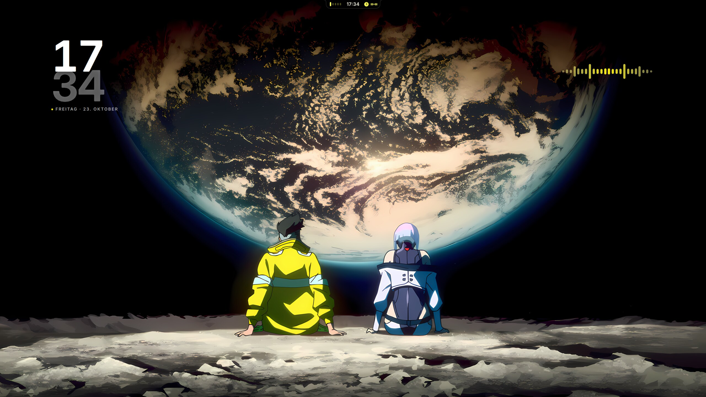
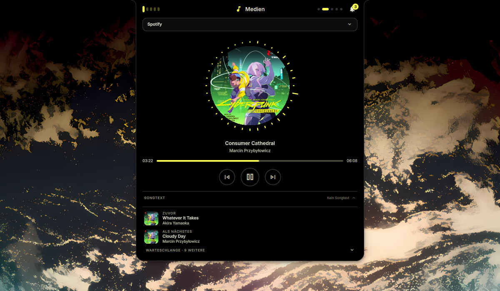
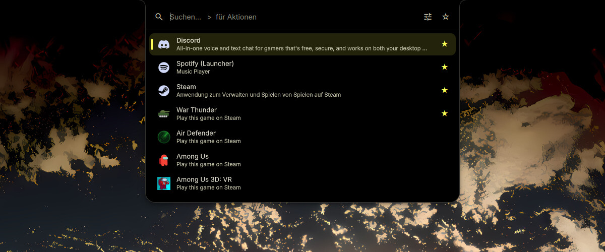
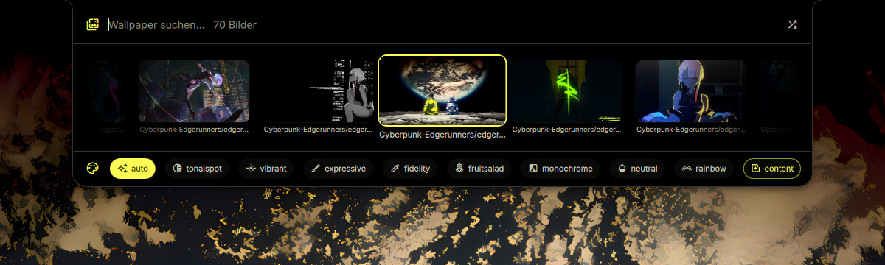
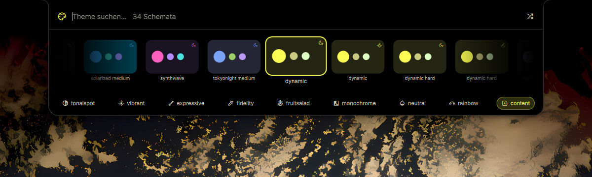
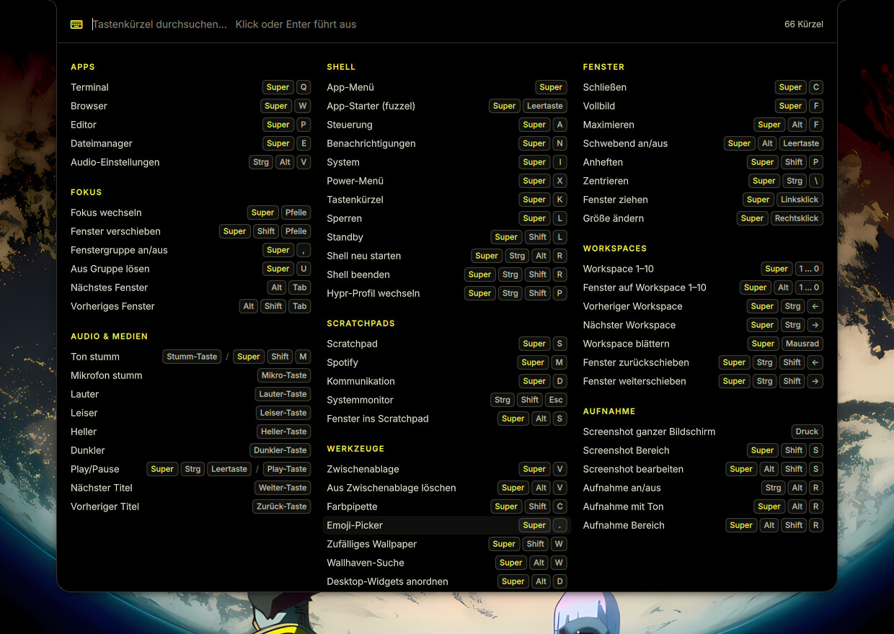

# Hyprland-Rice — Dynamic Island

[English](README.md) · **Deutsch**

> [!WARNING]
> **KI-Hinweis:** Ein grosser Teil dieses Repos — die Quickshell-Oberflaeche,
> die CLI, das Installationsskript und auch diese README — wurde mit KI
> (Claude Code) geschrieben. Ich nutze das selbst taeglich, aber es ist ein
> Hobby-Projekt ohne Review durch Dritte. Das Installationsskript fasst dein
> System an (Symlinks, Verzeichnisse, Farbschema-Dateien fuer GTK/Qt/btop/
> Discord) — lies es durch, bevor du es laufen laesst.

Meine persoenliche Hyprland-Konfiguration mit eigener Quickshell-Oberflaeche
("dynamic-island"): eine schwarze Notch oben in der Mitte, die sich zu
Medien-Player, Schnelleinstellungen, App-Menue, Systemmonitor, Wallpaper- und
Theme-Auswahl aufklappt. Die Farben folgen dem Wallpaper (Material You), und
jedes Wallpaper kann eigene Desktop-Widgets haben. Dazu kommt die CLI
`dynamic-island` fuer Farbschemata, Wallpaper, Screenshots und Aufnahmen.

Das ist die Config genau so, wie sie auf meinen Rechnern laeuft — inklusive
meiner Monitornamen und zwei Profilen, die Shells brauchen, die hier nicht
drin sind (siehe [Profile](#profile)).

Die Oberflaeche spricht **Englisch** (Vorgabe) und **Deutsch** — umschalten
unter Einstellungen > Darstellung > Sprache.



<table>
  <tr>
    <td width="50%"><br><sub><b>Medien</b> — Cover, Songtext, Warteschlange (ueber die Notch)</sub></td>
    <td width="50%"><br><sub><b>Steuerung</b> — Schnelleinstellungen wie bei Android (<code>SUPER + A</code>)</sub></td>
  </tr>
  <tr>
    <td><br><sub><b>App-Menue</b> — <code>&gt;</code> fuer Aktionen (<code>SUPER</code>)</sub></td>
    <td><br><sub><b>System</b> — CPU, GPU, RAM, Temperaturen (<code>SUPER + I</code>)</sub></td>
  </tr>
  <tr>
    <td><br><sub><b>Wallpaper</b> — Farbschema folgt dem Bild</sub></td>
    <td><br><sub><b>Themes</b> — fertige und generierte Schemata</sub></td>
  </tr>
</table>


<sub><b>Tastenkuerzel-Uebersicht</b> (<code>SUPER + K</code>) — live aus Hyprland, Klick fuehrt aus, Kuerzel lassen sich dort neu belegen</sub>

## Installieren

```sh
git clone https://github.com/Gamecat-HD/Hyprland-Rice.git
cd Hyprland-Rice
./dynamic-island/install.sh --install-deps
```

Das Skript verteilt `hypr/`, `quickshell/dynamic-island/` und
`dynamic-island/` nach `~/.config` — standardmaessig als Symlinks, damit ein
`git pull` im Klon sofort gilt. Was dort schon liegt, wandert vorher nach
`~/backups/`, nichts wird geloescht. Ausserdem kopiert es die mitgelieferten
Wallpaper nach `~/Pictures/Wallpapers` (vorhandene Dateien bleiben) und
erzeugt daraus das erste Farbschema.

Danach:

```sh
hyprctl reload            # Hyprland liest die neue Config
dynamic-island shell -d   # Shell starten
```

Wo der Klon liegt, ist egal. Wer den Klon lieber *als* `~/.config` haben will,
kann das auch — dann faellt das Verteilen weg.

### Optionen

| Option | Wirkung |
| --- | --- |
| `--install-deps` | fehlende Pakete per `paru`/`yay` mitinstallieren |
| `--copy` | kopieren statt verlinken (nach `git pull` erneut ausfuehren) |
| `--check` | nur pruefen, nichts aendern |
| `--dry-run` | zeigen, was passieren wuerde |
| `-y` | ohne Rueckfrage durchlaufen |

## Erste Schritte nach der Installation

Die Config ist auf meinen Rechner zugeschnitten. Ein paar Stellen musst du
fast sicher anpassen. Durch die Symlinks ist `~/.config/hypr` derselbe Ordner
wie `hypr/` im Klon — egal wo du bearbeitest, es ist dieselbe Datei.
Nach jeder Aenderung: `hyprctl reload`. Tippfehler meldet Hyprland oben als
rote Leiste.

### 1. Monitore (wichtigster Punkt)

Erst nachschauen, wie deine Bildschirme heissen:

```sh
hyprctl monitors    # Namen wie HDMI-A-1, DP-1, eDP-1 + moegliche Aufloesungen
```

In `hypr/hyprland.lua` stehen oben meine drei (`HDMI-A-1` links, `DP-2`
rechts, `eDP-1` = Laptop). Trag dort deine Namen, Aufloesung, Hz-Zahl und
Position ein, ueberzaehlige Bloecke loeschen. Beispiel fuer einen Monitor:

```lua
hl.monitor({
    output   = "DP-1",            -- Name aus `hyprctl monitors`
    mode     = "1920x1080@144",   -- oder "preferred"
    position = "0x0",
    scale    = 1,
})
```

Dann in `hypr/profiles/simple.lua` bei `wsMonitorOffset` dieselben Namen
eintragen. Jeder Monitor bekommt seine eigenen Workspaces 1–10; der erste
hat Offset `0`, ein zweiter `10`. Bei nur einem Monitor:

```lua
wsMonitorOffset = {
    ["DP-1"] = 0,
},
```

### 2. Tastatur

`kbLayout = "de"` in `hypr/profiles/simple.lua` — fuer US-Tastatur `"us"`.

### 3. Programme

Ganz oben in `hypr/profiles/simple.lua` (Block `cfg`) steht, welche Apps die
Tastenkuerzel starten: `kitty` (Terminal), `zen-browser`, `codium` (Editor),
`dolphin` (Dateien), `pavucontrol` (Audio), `fuzzel` (Launcher). Was du nicht
installiert hast, entweder installieren oder durch dein Programm ersetzen —
sonst passiert beim Kuerzel einfach nichts.

### 4. Wallpaper

Meine Sammlung liegt in `wallpapers/` (nach Ordnern sortiert: Cyberpunk
Edgerunners, Miku, Lord of the Mysteries, …) und landet beim Installieren in
`~/Pictures/Wallpapers`. Eigene Bilder einfach dazulegen (auch in
Unterordner) und per `>wallpaper` im App-Menue,
`dynamic-island wallpaper -f BILD` oder ueber die Wallhaven-Suche
(`SUPER + ALT + W`) setzen. Das Farbschema entsteht dabei aus dem Bild.

## Tastenkuerzel

`SUPER` ist die Windows-Taste. Gilt fuer das Profil `simple`. Alle Kuerzel
zeigt `SUPER + K` — dort kann man sie auch neu belegen oder abschalten.

| Kuerzel | Was passiert |
| --- | --- |
| `SUPER` (allein) | App-Menue der Shell |
| `SUPER + Space` | fuzzel-Launcher |
| `SUPER + Q` / `W` / `E` / `P` | Terminal / Browser / Dateimanager / Editor |
| `SUPER + C` | Fenster schliessen |
| `ALT + TAB` | naechstes Fenster |
| `SUPER + F` / `SUPER + ALT + F` | Vollbild / maximieren |
| `SUPER + ALT + Space` | Fenster schwebend (floating) |
| `SUPER + Pfeiltasten` | Fokus wechseln |
| `SUPER + SHIFT + Pfeiltasten` | Fenster verschieben |
| `SUPER + linke Maustaste` / `rechte` | Fenster ziehen / Groesse aendern |
| `SUPER + 1…0` | Workspace 1–10 (des Monitors unter dem Fokus) |
| `SUPER + ALT + 1…0` | Fenster auf Workspace 1–10 schieben |
| `CTRL + SUPER + ←/→` | vorheriger / naechster Workspace |
| `SUPER + S` | Scratchpad-Workspace ein/aus |
| `SUPER + M` | Spotify-Workspace (startet Spotify bei Bedarf) |
| `SUPER + D` | Discord-Workspace |
| `CTRL + SHIFT + Esc` | Systemmonitor (btop) |
| `SUPER + A` / `N` / `I` / `X` | Steuerung / Benachrichtigungen / System / Power |
| `SUPER + K` | Tastenkuerzel-Uebersicht |
| `SUPER + L` / `SUPER + SHIFT + L` | Bildschirm sperren / Standby |
| `SUPER + V` | Zwischenablage-Verlauf |
| `SUPER + .` | Emoji-Picker |
| `Druck` / `SUPER + SHIFT + S` | Screenshot ganzer Bildschirm / Bereich |
| `SUPER + SHIFT + C` | Farbpipette |
| `CTRL + ALT + R` | Bildschirmaufnahme starten/stoppen |
| `SUPER + SHIFT + W` | zufaelliges Wallpaper |
| `CTRL + SUPER + SHIFT + T` | zufaelliges Farbschema |
| `SUPER + ALT + W` | Wallpaper von wallhaven.cc suchen |
| `SUPER + ALT + D` | Desktop-Widgets anordnen (`Esc` = fertig) |
| `CTRL + SUPER + ALT + R` | Shell neu starten |

Die Vorgaben stehen unten in `hypr/profiles/simple.lua` unter `Keybinds`;
Aenderungen aus der Uebersicht landen in `~/.config/dynamic-island/keybinds.json`.

## Desktop-Widgets und Plugins

Die Desktop-Widgets haengen am Wallpaper: `dynamic-island/scenes.json` ordnet
jedem Bild (oder ganzen Ordner, Schluessel mit `/` am Ende) eine Liste von
Widgets mit Position und Stil zu. Die mitgelieferte Datei ist fuer die
mitgelieferten Wallpaper schon angeordnet; fuer eigene Bilder:
`SUPER + ALT + D`, Widgets per Maus verschieben, Rechtsklick fuegt neue hinzu.

Widgets und ein paar Extras sind Plugins (`quickshell/dynamic-island/plugins/`),
an- und abschalten unter Einstellungen > Plugins:

| Plugin | Was es macht |
| --- | --- |
| Desktop-Widgets | die Widget-Ebene selbst, dazu Uhr, Visualiser und Songtext |
| Kalender, Wetter, Systemmonitor, Jetzt laeuft | weitere Desktop-Widgets (Wetter von open-meteo, ohne API-Key) |
| Matrix-Regen, Bonsai, Terminal-Widget | Deko: Matrix als GPU-Shader, ASCII-Bonsai, beliebiges Terminal-Programm (cmatrix, cava, btop …) in einem durchsichtigen kitty-Panel |
| Wallhaven | wallhaven.cc direkt in der Wallpaper-Auswahl durchsuchen, mit Live-Vorschau |
| Terminal-Looks | starship-Prompt und fastfetch folgen dem Farbschema oder dem Look des Wallpaper-Ordners (standardmaessig aus) |

Plugins lassen sich als `.dip`-Paket exportieren und importieren, in den
Einstellungen oder per `dynamic-island plugin export|import`. Eigene Plugins:
mit `dynamic-island plugin new <id>` anfangen, das Format steht (englisch) in
[`quickshell/dynamic-island/plugins/README.md`](quickshell/dynamic-island/plugins/README.md).

Die Shell selbst stellt man im Einstellungsfenster ein (`>settings` im
App-Menue) — das schreibt `~/.config/dynamic-island/shell.json`.

## Updates holen

```sh
cd Hyprland-Rice   # dein Klon
git pull
hyprctl reload
```

Hast du selbst Dateien geaendert (z. B. die Monitore), kann `git pull`
meckern. Dann so:

```sh
git stash && git pull && git stash pop
```

Pushen geht nicht, das Repo ist fuer andere nur lesbar. Wenn du deine
Aenderungen selbst auf GitHub sichern willst: oben rechts auf **Fork**, dann
deinen Fork klonen.

## Wenn was nicht geht

* **Was fehlt?** `./dynamic-island/install.sh --check`
* **Keine Leiste / kein Wallpaper:** `hypr-profile status` zeigt, was laeuft.
  Meistens hilft `hypr-profile simple` oder `CTRL + SUPER + ALT + R`.
  Fehlermeldungen: `qs -c dynamic-island log`.
* **Profil-Umschalter:** `CTRL + SUPER + SHIFT + P` schaltet zwischen
  `caelestia`, `simple` und `shell2` durch. Die anderen beiden sind meine
  Bastel-Profile und brauchen Shells, die nicht im Repo sind — fuer dich ist
  nur `simple` sinnvoll. Aus Versehen gewechselt? `hypr-profile simple`.
* **Fehler in `simple.lua`:** Dann springt Hyprland automatisch auf das
  Profil `caelestia` zurueck (Fenster gehen, Leiste fehlt). Fehler beheben,
  danach `hypr-profile simple`.
* **Leere Kaestchen statt Icons:** die Schrift Material Symbols fehlt
  (`ttf-material-symbols-variable-git` aus dem AUR).
* **Benachrichtigungen kommen nicht an:** ein anderer Daemon (mako, dunst,
  swaync) belegt den DBus-Namen — abschalten, die Shell bringt ihren eigenen mit.
* **Bildschirm teilen (Discord, OBS) geht nicht:** Hyprland startet beim
  Login `hyprland-session.target`. Die Datei fehlt bei dir noch, einmal
  anlegen:

  ```sh
  mkdir -p ~/.config/systemd/user
  cat > ~/.config/systemd/user/hyprland-session.target <<'EOF'
  [Unit]
  Description=Hyprland session
  BindsTo=graphical-session.target
  Before=graphical-session.target
  Wants=graphical-session-pre.target
  After=graphical-session-pre.target
  EOF
  systemctl --user daemon-reload
  ```

  Danach einmal ab- und wieder anmelden.

## Voraussetzungen

Hyprland **mit Lua-Konfiguration** (getestet mit 0.56) — die Config ist
`hypr/hyprland.lua`, keine `hyprland.conf`. Dazu Quickshell (getestet mit
0.3.1), Python mit `pillow` und `materialyoucolor`, die Material-Symbols-
Schrift und die ueblichen Wayland-Werkzeuge.

Mehrere Anzeigen haengen an Systemdiensten, mit denen die Shell ueber DBus
redet: **NetworkManager** (WLAN), **bluez** (Bluetooth), **upower** (Akku) und
**power-profiles-daemon** (Energieprofile). Optional sind `cava` (Balken im
Medien-Player), `ddcutil` (Helligkeit ueber DDC/CI), `nordvpn` und `warp-cli`
(waehlbare Anbieter der VPN-Kachel) — ohne sie faellt nur die jeweilige
Einzelheit aus.

`./dynamic-island/install.sh --check` sagt, was davon fehlt.

## Profile

`~/.config/hypr/profile` entscheidet, welches Profil Hyprland laedt:

* `simple` — diese Rice mit der dynamic-island-Shell
* `caelestia` — die volle Config mit der Caelestia-Shell (die liegt nicht in
  diesem Repo)
* `shell2` — Testprofil fuer eine neue Shell (liegt ebenfalls nicht hier)

Umschalten: `hypr-profile toggle` oder `CTRL + SUPER + SHIFT + P`.

## Credits und Lizenz

* Die CLI in `dynamic-island/` ist von
  [caelestia-cli](https://github.com/caelestia-dots/cli) abgeleitet und steht
  wie diese unter der **GPL-3.0** ([`dynamic-island/LICENSE`](dynamic-island/LICENSE)).
* Die Optik der Notch ist von saneAspects "Dynamite" inspiriert.
* Die Wallpaper gehoeren ihren jeweiligen Kuenstlerinnen und Kuenstlern
  (gesammelt u. a. auf [wallhaven.cc](https://wallhaven.cc)), siehe
  [`wallpapers/README.md`](wallpapers/README.md).
