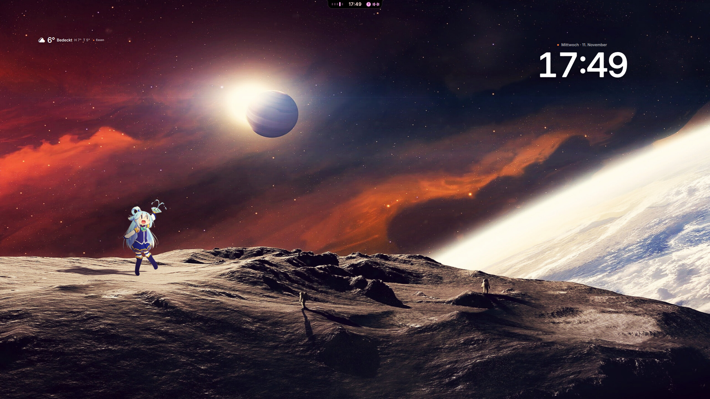
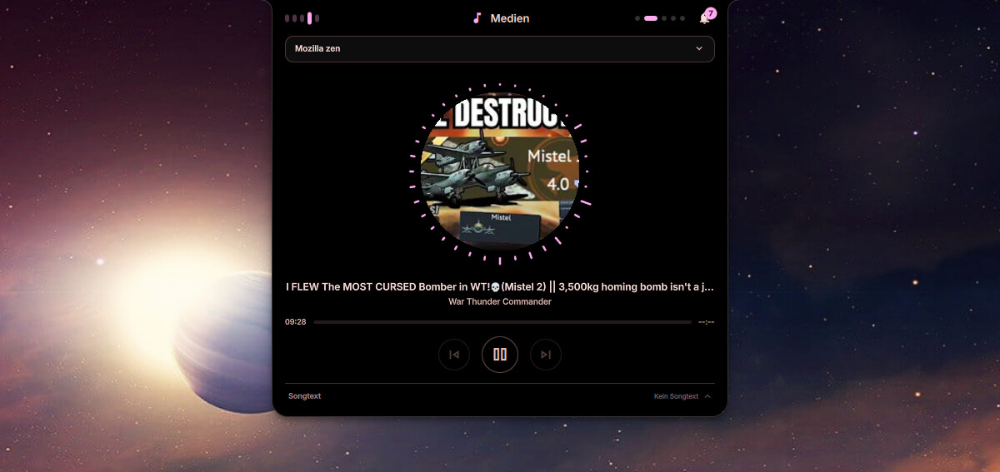
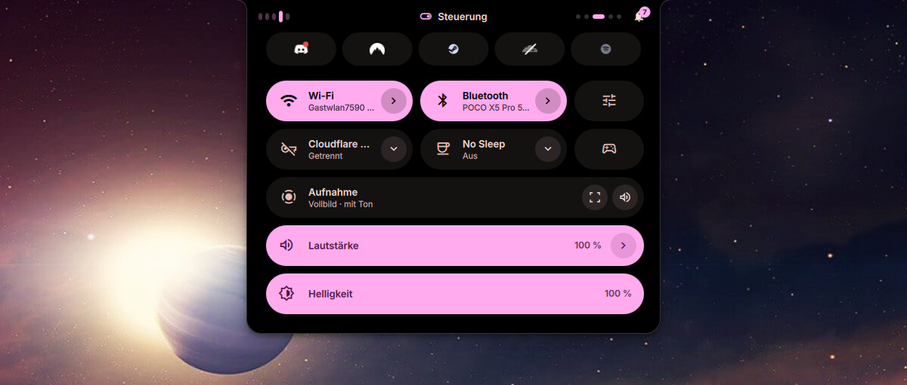
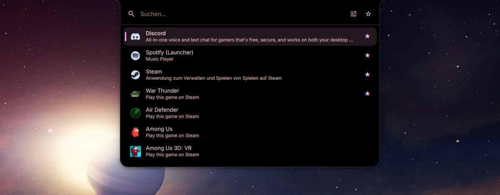
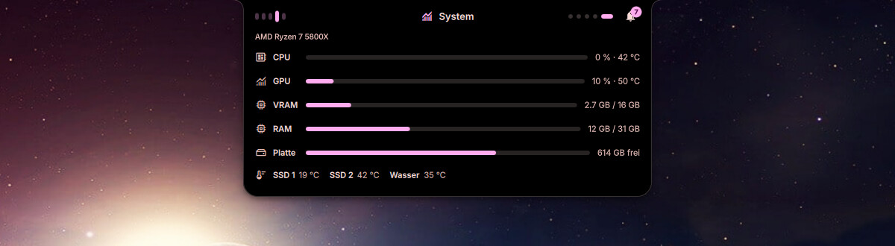
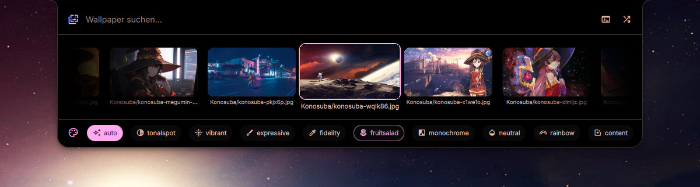
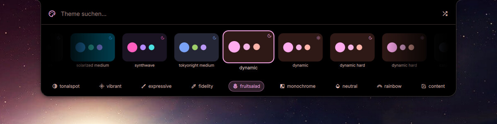
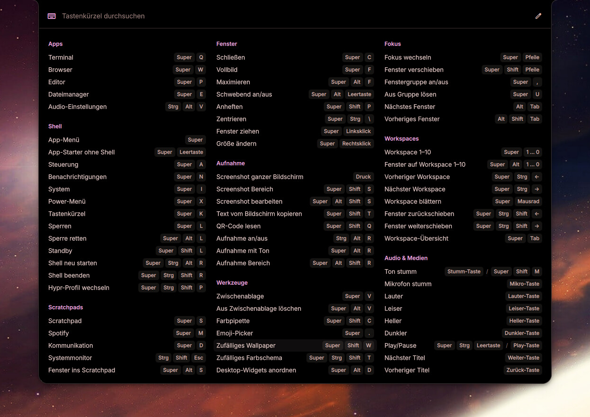

# Hyprland-Rice — Dynamic Island

**English** · [Deutsch](README.de.md)

> [!WARNING]
> **AI notice:** A large part of this repo — the Quickshell interface, the
> CLI, the install script and this README — was written with AI
> (Claude Code). I use it every day myself, but it is a hobby project that
> nobody else has reviewed. The install script changes your system (symlinks,
> directories, color scheme files for GTK/Qt/btop/Discord) — read it before
> you run it.

My personal Hyprland config with its own Quickshell interface
("dynamic-island"): a black notch at the top center that expands into a media
player, quick settings, app menu, system monitor, wallpaper and theme picker.
The colors follow the wallpaper (Material You), and every wallpaper can have
its own desktop widgets. On top of that, the `dynamic-island` CLI handles
color schemes, wallpapers, screenshots and screen recording.

This is the config exactly as it runs on my machines — including two profiles that need shells not included here (see
[Profiles](#profiles)).

The interface speaks **English** (default) and **German** — switch it under
Settings > Language & region.



<table>
  <tr>
    <td width="50%"><br><sub><b>Media</b> — cover, lyrics, queue (via the notch)</sub></td>
    <td width="50%"><br><sub><b>Controls</b> — Android-style quick settings (<code>SUPER + A</code>)</sub></td>
  </tr>
  <tr>
    <td><br><sub><b>App menu</b> — <code>&gt;</code> for actions (<code>SUPER</code>)</sub></td>
    <td><br><sub><b>System</b> — CPU, GPU, RAM, temperatures (<code>SUPER + I</code>)</sub></td>
  </tr>
  <tr>
    <td><br><sub><b>Wallpapers</b> — the color scheme follows the image</sub></td>
    <td><br><sub><b>Themes</b> — ready-made and generated schemes</sub></td>
  </tr>
</table>


<sub><b>Keybind overview</b> (<code>SUPER + K</code>) — live from Hyprland, click to run, <code>Ctrl + E</code> opens the editor in the settings</sub>

<sub>The screenshots show the German interface.</sub>

## Installing

```sh
git clone https://github.com/Gamecat-HD/Hyprland-Rice.git
cd Hyprland-Rice
./install.sh --install-deps
```

`config/` in the repo mirrors `~/.config`. The script places `hypr/`,
`quickshell/dynamic-island/` and `dynamic-island/` from it into `~/.config` —
as symlinks by default, so a `git pull` in the clone
applies right away. Whatever is already there is moved to `~/backups/` first;
nothing is deleted. It also copies the bundled wallpapers to
`~/Pictures/Wallpapers` (existing files are left alone) and generates the
first color scheme from them. For the see-through terminal it places
`config/kitty/dynamic-island.conf` in `~/.config/kitty/` and appends a marked
`include` block to your `kitty.conf` (nothing else in that file is touched;
your own values below the block win).

Then:

```sh
hyprctl reload            # Hyprland reads the new config
dynamic-island shell -d   # start the shell
```

It doesn't matter where the clone lives.

### Options

| Option | Effect |
| --- | --- |
| `--install-deps` | also install missing packages with `paru`/`yay` |
| `--copy` | copy instead of symlink (run again after `git pull`) |
| `--extras` | also link my hyprlock layouts, nvim, spicetify and spotify-launcher configs (replaces yours, backed up to `~/backups/`) |
| `--check` | only check, change nothing |
| `--monitors` | only (re)write `~/.config/hypr/monitors.lua` from the connected monitors |
| `--dry-run` | show what would happen |
| `-y` | run without asking |

## First steps after installing

The config is tailored to my machine. You'll almost certainly have to adjust
a few things. Thanks to the symlinks, `~/.config/hypr` is the same folder as
`config/hypr/` in the clone — wherever you edit, it's the same file. After every
change: `hyprctl reload`. Hyprland reports typos as a red bar at the top.

### 1. Monitors

Monitors live in `~/.config/hypr/monitors.lua` — a file per machine that is
not part of the repo (it's in `.gitignore`, so `git pull` never touches it).
`install.sh` writes it from the monitors that are connected right now, if
Hyprland is running. Installed from a TTY? Then run this once inside Hyprland:

```sh
./install.sh --monitors   # writes monitors.lua from `hyprctl monitors`
hyprctl reload
```

Settings > Monitors writes the same file: arrangement, resolution,
refresh rate and scale, with a timer that reverts a setting that leaves you
with a black screen.

Without the file everything still works: every monitor gets its preferred
resolution, and the workspace groups are handed out left to right.

The file looks like this (template with all options:
`config/hypr/monitors.example.lua`):

```lua
return {
    {
        output     = "DP-1",            -- name from `hyprctl monitors`
        mode       = "1920x1080@144",   -- or "preferred"
        position   = "0x0",
        scale      = 1,
        workspaces = 0,                 -- this monitor has workspaces 1-10
    },
    {
        output     = "HDMI-A-1",
        mode       = "preferred",
        position   = "1920x0",
        scale      = 1,
        workspaces = 10,                -- 11-20 (SUPER+1 here jumps to 11)
    },
}
```

Every monitor gets its own workspaces 1–10 (shown as 1–10 in the bar).

### 2. Keyboard

`kbLayout = "de"` in `config/hypr/profiles/simple.lua` — `"us"` for a US keyboard.

### 3. Programs

The top of `config/hypr/profiles/simple.lua` (the `cfg` block) defines which apps the
keybinds launch: `kitty` (terminal), `zen-browser`, `codium` (editor),
`dolphin` (files), `pavucontrol` (audio), `fuzzel` (launcher). Install what
you're missing or replace it with your own program — otherwise the keybind
simply does nothing.

### 4. Wallpapers

My collection is in `wallpapers/` (sorted into folders: Cyberpunk
Edgerunners, Miku, Lord of the Mysteries, …) and is copied to
`~/Pictures/Wallpapers` on install. Just drop your own images in there
(subfolders work too) and pick one with `>wallpaper` in the app menu,
`dynamic-island wallpaper -f IMAGE` or the Wallhaven search
(`SUPER + ALT + W`). The color scheme is generated from the image.

## Keybinds

`SUPER` is the Windows key. Applies to the `simple` profile. `SUPER + K`
shows all keybinds; rebind or disable them under Settings > Keyboard shortcuts
(`Ctrl + E` in the overview).

| Keybind | What happens |
| --- | --- |
| `SUPER` (alone) | the shell's app menu |
| `SUPER + Space` | fuzzel launcher |
| `SUPER + Q` / `W` / `E` / `P` | terminal / browser / file manager / editor |
| `SUPER + C` | close window |
| `ALT + TAB` | next window |
| `SUPER + F` / `SUPER + ALT + F` | fullscreen / maximize |
| `SUPER + ALT + Space` | toggle floating |
| `SUPER + arrow keys` | move focus |
| `SUPER + SHIFT + arrow keys` | move window |
| `SUPER + left mouse` / `right` | drag window / resize |
| `SUPER + 1…0` | workspace 1–10 (of the focused monitor) |
| `SUPER + ALT + 1…0` | move window to workspace 1–10 |
| `CTRL + SUPER + ←/→` | previous / next workspace |
| `SUPER + Tab` | workspace overview |
| `SUPER + S` | toggle scratchpad workspace |
| `SUPER + M` | Spotify workspace (starts Spotify if needed) |
| `SUPER + D` | Discord workspace |
| `CTRL + SHIFT + Esc` | system monitor (btop) |
| `SUPER + A` / `N` / `I` / `X` | controls / notifications / system / power |
| `SUPER + K` | keybind overview |
| `SUPER + L` / `SUPER + SHIFT + L` | lock screen / suspend |
| `SUPER + V` | clipboard history |
| `SUPER + .` | emoji picker |
| `Print` / `SUPER + SHIFT + S` | screenshot of the whole screen / a region |
| `SUPER + SHIFT + C` | color picker |
| `CTRL + ALT + R` | start/stop screen recording |
| `SUPER + SHIFT + W` | random wallpaper |
| `CTRL + SUPER + SHIFT + T` | random color scheme |
| `SUPER + ALT + W` | search wallpapers on wallhaven.cc |
| `SUPER + ALT + D` | arrange desktop widgets (`Esc` = done) |
| `CTRL + SUPER + ALT + R` | restart the shell |

The defaults are at the bottom of `config/hypr/profiles/simple.lua` under
`Keybinds`; changes made in the settings are stored in
`~/.config/dynamic-island/keybinds.json`.

## Desktop widgets and plugins

The desktop widgets belong to the wallpaper: `config/dynamic-island/scenes.json`
maps each image (or a whole folder, keys ending in `/`) to a list of widgets
with position and style. The bundled file is already arranged for the
bundled wallpapers; for your own images, press `SUPER + ALT + D`, move
widgets with the mouse and right-click to add new ones.

Widgets and a few extras are plugins (`config/quickshell/dynamic-island/plugins/`),
turned on and off under Settings > Plugins:

| Plugin | What it does |
| --- | --- |
| Desktop widgets | the widget layer itself, plus clock, visualizer and lyrics |
| Calendar, Weather, System monitor, Now playing | more desktop widgets (weather from open-meteo, no API key) |
| Matrix rain, Bonsai, Terminal widget | eye candy: GPU-shader matrix, ASCII bonsai, any terminal program (cmatrix, cava, btop …) in a transparent kitty panel |
| Workspace overview | all workspaces as tiles, one tab per monitor — fullscreen or inside the notch (`SUPER + Tab`) |
| Wallhaven | search wallhaven.cc right in the wallpaper picker, with live preview |
| Terminal looks | starship prompt and fastfetch follow the color scheme or the wallpaper folder's look (off by default) |

Plugins can be exported and imported as `.dip` packages, from the settings or
with `dynamic-island plugin export|import`. To write your own: start with
`dynamic-island plugin new <id>`; the format is documented in
[`config/quickshell/dynamic-island/plugins/README.md`](config/quickshell/dynamic-island/plugins/README.md).

The shell itself is configured in the settings window (`>settings` in the
app menu): appearance and wallpaper library, the notch (every part of it can
be switched off), bar, quick-settings tiles, notifications, Bluetooth & VPN,
battery, lock screen & standby, monitors, keyboard shortcuts, language. It
writes `~/.config/dynamic-island/shell.json`.

## Updating

```sh
cd Hyprland-Rice   # your clone
git pull
hyprctl reload
```

If you changed files yourself (e.g. the keyboard layout), `git pull` may complain.
Then:

```sh
git stash && git pull && git stash pop
```

Or under Settings > About > Updates: it pulls, keeps your own commits on top
and restarts the shell.

You can't push — the repo is read-only for others. If you want to keep your
own changes on GitHub: click **Fork** at the top right, then clone your fork.

## When something doesn't work

* **What's missing?** `./install.sh --check`
* **No bar / no wallpaper:** `hypr-profile status` shows what's running.
  Usually `hypr-profile simple` or `CTRL + SUPER + ALT + R` helps. Error
  messages: `qs -c dynamic-island log`.
* **Profile switcher:** `CTRL + SUPER + SHIFT + P` cycles through
  `simple`, `shell2` and `caelestia`. The other two are my tinkering profiles
  and need shells that aren't in this repo — only `simple` makes sense for
  you. Switched by accident? `hypr-profile simple`.
* **Error in `simple.lua`:** for that session Hyprland falls back to the
  full config of the `caelestia` profile (windows and keybinds work, the bar
  is missing). Fix the error, then `hyprctl reload`.
* **Empty boxes instead of icons:** the Material Symbols font is missing
  (`ttf-material-symbols-variable-git` from the AUR).
* **Notifications don't arrive:** another daemon (mako, dunst, swaync) owns
  the DBus name — turn it off, the shell brings its own.
* **Screen sharing (Discord, OBS) doesn't work:** Hyprland starts
  `hyprland-session.target` at login. You don't have that file yet, create it
  once:

  ```sh
  mkdir -p ~/.config/systemd/user
  cat > ~/.config/systemd/user/hyprland-session.target <<'EOF'
  [Unit]
  Description=Hyprland session
  BindsTo=graphical-session.target
  Before=graphical-session.target
  Wants=graphical-session-pre.target
  After=graphical-session-pre.target
  EOF
  systemctl --user daemon-reload
  ```

  Then log out and back in once.

## Requirements

Hyprland **with the Lua config** (tested with 0.56) — the config is
`config/hypr/hyprland.lua`, not a `hyprland.conf`. Plus Quickshell (tested with
0.3.1), Python with `pillow` and `materialyoucolor`, the Material Symbols
font and the usual Wayland tools.

Several indicators depend on system services the shell talks to over DBus:
**NetworkManager** (Wi-Fi), **bluez** (Bluetooth), **upower** (battery) and
**power-profiles-daemon** (power profiles). Optional: `cava` (bars in the
media player), `ddcutil` (brightness via DDC/CI), `nordvpn` and `warp-cli`
(selectable providers for the VPN tile) — without them only that particular
feature is missing.

`./install.sh --check` tells you what's missing.

## Profiles

`~/.config/hypr/profile` decides which profile Hyprland loads:

* `simple` — this rice with the dynamic-island shell (default)
* `shell2` — test profile for a new shell (not in this repo)
* `caelestia` — the full config with the Caelestia shell (not in here
  either). Separate from this rice; its caelestia-cli config lives in
  `config/caelestia/cli.json`.

Switch: `hypr-profile toggle` or `CTRL + SUPER + SHIFT + P`.

## Credits and license

* The CLI in `config/dynamic-island/` is derived from
  [caelestia-cli](https://github.com/caelestia-dots/cli) and, like it, is
  licensed under the **GPL-3.0** ([`config/dynamic-island/LICENSE`](config/dynamic-island/LICENSE)).
* Everything else in this repository is also licensed under the **GPL-3.0** ([`LICENSE`](LICENSE)),
  except the wallpapers (see below) and `config/nvim/` (Apache-2.0, from the LazyVim starter).
* The look of the notch is inspired by saneAspect's "Dynamite".
* The wallpapers belong to their respective artists (collected among others
  from [wallhaven.cc](https://wallhaven.cc)), see
  [`wallpapers/README.md`](wallpapers/README.md).
